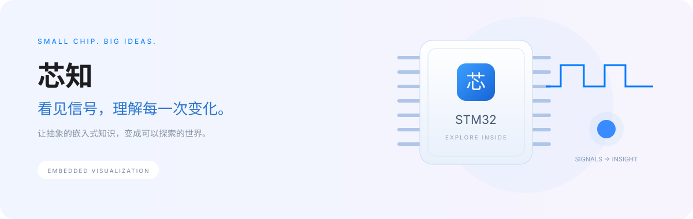

<p align="center">
  
</p>

<div align="center">

# 芯知 · Embedded Visualization

**面向嵌入式学习者的交互式原理实验室**

让电路、数据流与时序同步发生，建立对 STM32 外设的直觉。

[](https://github.com/luozhang1024/Embedded-Visualization/releases)
[](LICENSE)
[](https://github.com/luozhang1024/Embedded-Visualization/actions/workflows/validate.yml)
[](https://github.com/luozhang1024/Embedded-Visualization/stargazers)
[](#快速开始)

[快速开始](#快速开始) · [实验目录](#实验目录) · [参与贡献](#参与贡献) · [更新记录](CHANGELOG.md)

</div>

## 项目简介

芯知将嵌入式外设的工作过程转化为可操作、可观察的学习体验。调整参数，逐步执行或拖动时间轴，即可同时观察原理图、信号电平、数据位和结果变化，并通过对应的 HAL 代码连接到实际开发。

当前版本为 **v0.4.0 Preview**。版本徽章对应仓库源码版本；发布记录以 [Releases](https://github.com/luozhang1024/Embedded-Visualization/releases) 页面为准。

## 核心特性

- **循序故事演示**：SPI 默认从五幕故事开始，按命令、数据与返回逐幕播放并自动停下；双向位队列、接收盒和手动时钟帮助分清“收全字节”与“函数返回”。理解后可切换真实信号视图，进度保持同步。
- **外设专属场景**：GPIO 输出级、串行字节、双线总线、ADC 量化阶梯、DMA 内存缓冲区，呈现不同外设的工作方式。
- **同步时序观察**：场景、波形、当前步骤与状态读数联动；支持播放、暂停、单步、回退和时间轴定位。
- **可操作的异常场景**：开漏输出悬空、I²C 地址无应答、DMA 固定地址覆盖，让易错概念更容易理解。
- **可扩展的实验目录**：侧边栏仅保留知识分类，具体实验通过卡片与搜索访问，避免外设列表持续拉长。
- **轻量运行**：原生 HTML、CSS、JavaScript 与 SVG，无构建步骤、无前端运行依赖、无第三方字体请求。
- **简洁界面**：浅色面板、系统字体、响应式布局、键盘焦点提示，并尊重系统减少动态效果设置。

## 实验目录

| 分类     | 模块  | 可观察内容                                    | 可调整参数                                      |
| -------- | ----- | --------------------------------------------- | ----------------------------------------------- |
| 基础外设 | GPIO  | 上下管开关、引脚高低电平、开漏释放            | 推挽 / 开漏、外部上拉                           |
| 通信协议 | USART | 起始位、D0–D7、停止位、逐位接收               | 数据字节、波特率                                |
| 通信协议 | I²C   | START、7 位地址、方向位、ACK/NACK、STOP       | 从机地址、数据字节、地址应答                    |
| 通信协议 | SPI   | STM32 ↔ nRF24L01 全双工、收发移位与寄存器读取 | STATUS / CONFIG / NOP、占位字节；另保留四种模式 |
| 模拟采集 | ADC   | 输入电压、量化等级、转换结果与 EOC            | 0–3.3 V 输入、8 / 10 / 12 位                    |
| 系统协同 | DMA   | 外设请求、内存写入、剩余传输数                | 传输长度、内存地址递增                          |

### 推荐探索

1. **GPIO**：选择开漏并移除上拉，定位到“写 1”，观察引脚为何处于高阻态。
2. **USART**：分别发送 `1` 与 `128`，比较 D0 与 D7 的位置，理解低位先传。
3. **I²C**：模拟地址 NACK，确认主机直接结束事务，不再发送数据字节。
4. **SPI**：先读 STATUS，再读 CONFIG，比较命令与数据阶段的双向返回；把占位字节从 `0xFF` 改为 `0x00`，观察读回数据是否改变。切换“基础 SPI”可继续探索四种时钟模式。
5. **ADC**：缓慢改变输入电压，比较不同分辨率下的量化结果与 LSB 大小。
6. **DMA**：关闭内存地址递增，观察 `buffer[0]` 被反复覆盖。

## 快速开始

### 直接打开

克隆仓库后，用现代浏览器打开 `index.html`，无需安装 npm 依赖。

```bash
git clone https://github.com/luozhang1024/Embedded-Visualization.git
cd Embedded-Visualization
```

### 本地服务

安装 Python 3 后，在项目目录执行：

```bash
python -m http.server 8080
```

访问 **http://localhost:8080**。从分类目录选择实验，调整右侧参数，通过播放或拖动时间轴观察变化。参数修改会重置当前实验进度；分类和搜索仅筛选目录，不会中断正在观察的实验。

## 开发与验证

运行页面无需 Node.js。开发测试需 Node.js **22.22.2+（22 系列）、24.15.0+（24 系列）或 26+**；具体要求见 `package.json`。

```bash
npm ci
npm run check
npm test
```

测试覆盖外设模型、UART 位序和帧时间、SPI 四种模式、I²C 应答与终止、ADC 边界、DMA 计数，以及分类搜索、时间轴、播放控制和参数有效性。界面交互测试使用 jsdom，不替代真实浏览器的布局、可访问性和视觉检查。GitHub Actions 在 Push 和 Pull Request 时执行检查。

```text
Embedded-Visualization/
├── index.html             # 页面结构与实验工作区
├── styles.css             # 设计样式与响应式布局
├── app.js                 # 外设模型、目录及交互控制
├── scenes.js              # 各外设专属 SVG 场景
├── nrf.js                 # nRF24L01 全双工事务模型与场景
├── spi-story.js           # 基于同一事务模型的分幕教学与双向位队列
├── tests/                 # 原理模型与 DOM 交互测试
├── docs/                  # 项目展示资源
├── .github/workflows/     # 自动验证
├── CHANGELOG.md           # 更新记录
└── LICENSE                # AGPL-3.0 完整许可文本
```

## 模型边界

芯知用于原理教学，不提供 STM32 指令级、寄存器级或电气级仿真。动画播放速度经过缩放，图中距离与相位宽度不代表真实硬件时间。

- **GPIO**：输出管为功能开关示意；灯光为高阻逻辑指示，不计算真实 LED 负载或上拉电阻的驱动能力。
- **USART**：仅演示异步发送的 8N1 格式，低位先传，不模拟接收过采样或帧错误。
- **I²C**：演示 7 位寻址、写方向和单字节写入；ACK 参数仅模拟地址应答，不模拟仲裁、时钟拉伸或读事务。
- **SPI**：基础场景保留 8 位 MSB first 发送与四种模式；nRF24L01 场景固定 Mode 0，展示 SCK / MOSI / MISO / CSN、STATUS / CONFIG 单字节读取与 NOP。STATUS 为可选静态快照、CONFIG 固定为教学示例 `0x0B`；不模拟无线收发、IRQ 变化、寄存器写入、具体器件的建立 / 保持时间。详见 [nRF24L01 SPI 实验说明](docs/nrf24-spi.md)。
- **ADC**：理想单端量化模型为 `min(2^N−1, floor(Vin / Vref × 2^N))`，`Vref = 3.3 V`。阶梯是概念示意，未逐格绘制全部量化等级；不模拟逐次逼近、噪声、偏移和采样保持电路。
- **DMA**：演示外设到内存的单次、字节宽度传输，不模拟总线仲裁、FIFO、缓存一致性或循环模式。

HAL 示例需配合实际芯片的时钟、引脚及外设初始化使用。不同 STM32 系列特性存在差异，请以对应参考手册与数据手册为准。

## 发展方向

以下为规划方向，尚未实现：

- [ ] 针对具体 STM32 系列增加寄存器视图与配置映射
- [ ] 扩展定时器、PWM、中断与时钟树
- [ ] 扩展 CAN、USB 等通信专题
- [ ] 增加 RTOS 调度、队列与同步机制可视化
- [ ] 增加实验任务、错误注入与学习进度

## 参与贡献

欢迎通过 [Issues](https://github.com/luozhang1024/Embedded-Visualization/issues) 提交需求、勘误与问题，或通过 Pull Request 贡献实验模块。

新增模块建议同时提供原理说明、交互参数、可观察状态、模型边界及必要测试。涉及芯片特定行为时，请注明系列 / 型号及参考手册来源。提交界面修改前，请检查桌面与移动端布局、键盘操作、播放控制及异常输入。

## 许可证

本项目采用 **GNU Affero General Public License v3.0（AGPL-3.0-only）**，完整条款见 [LICENSE](LICENSE)。修改后的程序通过网络向用户提供服务时，应按许可证要求向相关用户提供对应源码。

## Star History

[](https://www.star-history.com/#luozhang1024/Embedded-Visualization&Date)

Star History 图表由第三方服务提供，展示数据以 GitHub 实际统计为准。
